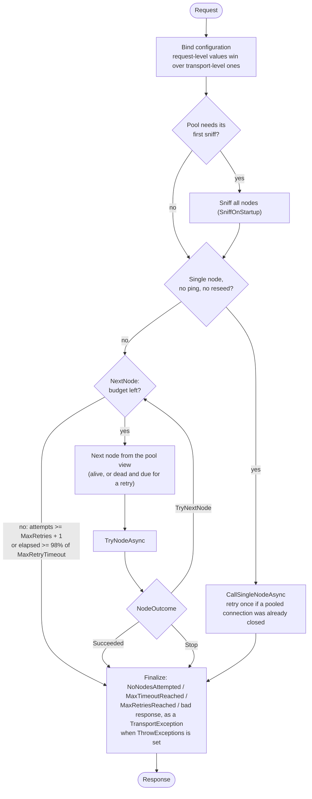
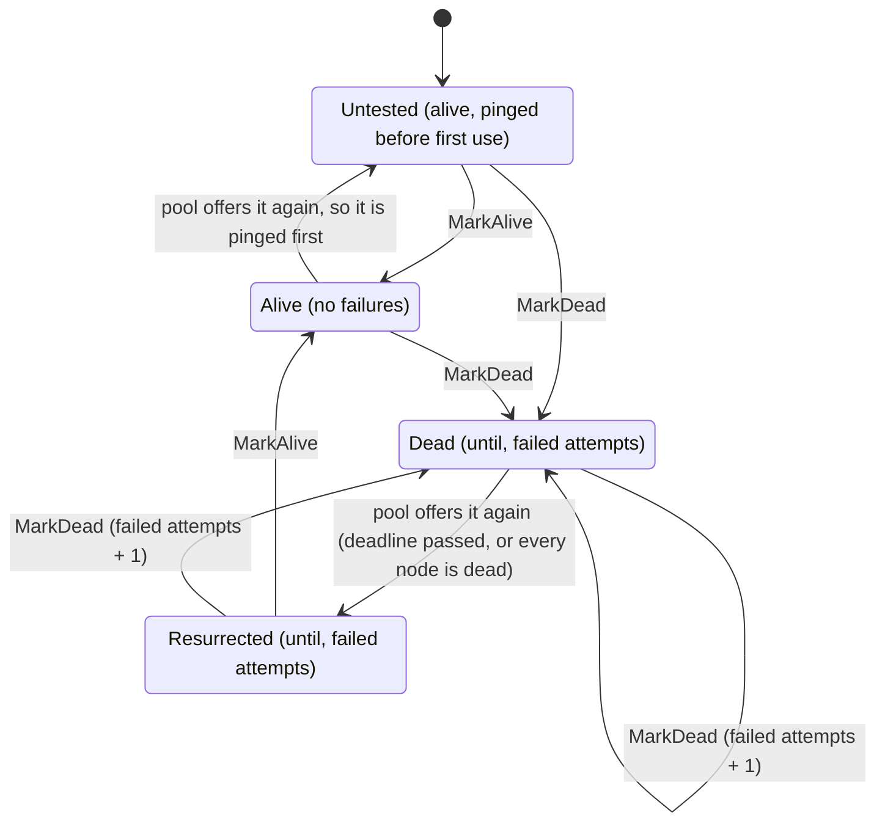

# The request pipeline

This page replaces the old `request-pipeline.png`. Every box below is a type, an enum value or a method in the code, so
the diagrams and the code can be checked against each other. The behaviour is pinned by the specs in
`tests/Elastic.Transport.Tests/ClientConcepts/ConnectionPooling` and by the model-based properties in
`tests/Elastic.Transport.Properties.Tests`.

## One request

`DistributedTransport.RequestCoreAsync` binds the configuration, makes sure the pool has been sniffed once if it should
be, then offers nodes one at a time until one succeeds or the budget is spent. What happens on one node is
`TryNodeAsync`, and its result is a `NodeOutcome`.



The budget is read from the request's own `RequestAttempt` at every step. It is never shared with another request.

## One node

```mermaid
flowchart TD
    a(["TryNodeAsync(node)"]) --> stale{"Cluster info stale?<br/>(SniffInformationLifeSpan)"}
    stale -- yes --> sniffStale["Sniff (SniffOnStaleCluster)"] --> ping
    stale -- no --> ping{"Pinging enabled and<br/>node IsResurrected?"}
    ping -- yes --> doPing["Ping (separate, short timeout)"]
    doPing -- "401" --> stop
    doPing -- fails --> failed
    doPing -- ok --> call
    ping -- no --> call["Call the product endpoint"]
    call -- "401" --> stop
    call --> ok{"Success or a known error?"}
    ok -- yes --> alive["MarkAlive"] --> succeeded
    ok -- no --> failed
    failed["MarkDead; sniff if SniffOnConnectionFault<br/>(a reseed makes NextNode start from a fresh view)"] --> cancelled{"Cancelled?"}
    cancelled -- yes --> stop
    cancelled -- no --> tryNext
    succeeded([NodeOutcome.Succeeded])
    tryNext([NodeOutcome.TryNextNode])
    stop([NodeOutcome.Stop])
```

In code the turn is a walk over `NodeStep` (`SniffIfStale`, `PingIfDue`, `Call`, `TakeOutOfRotation`, `Settle`, `Done`);
the failure edges above leave through exceptions that `RequestCoreAsync` classifies. The single-node path is a separate,
shorter loop on purpose: it never pings, sniffs, marks a node dead or alive, and has the one stale-connection retry.

`Stop` is for failures another node cannot fix: bad credentials (on the ping or on the call), an unrecoverable
pipeline failure, and cancellation.

## One node's health

A node's health is the `NodeHealth` union (`Components/NodePool/NodeHealth.cs`). The four states are the four meaningful
combinations of what used to be four separately written fields.



| State | `IsAlive` | `IsResurrected` (ping first) | `FailedAttempts` |
|---|:-:|:-:|---|
| `Untested` | yes | yes | 0 |
| `Alive` | yes | no | 0 |
| `Dead` | no | no | 1 or more |
| `Resurrected` | no | yes | 1 or more, kept so back-off continues |

Transitions are a compare-and-swap of the whole state, so two requests failing the same node cannot lose a failure.

## Sniffing

A sniff asks nodes for the cluster topology and reseeds the pool. It tries every node in turn and fails only when all of
them have failed, except that bad credentials end it at once. A successful sniff during a request asks that request
(and only that request) to restart its walk from the new view.
